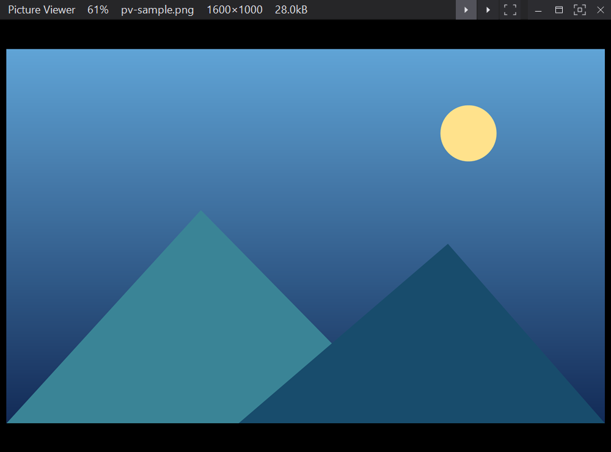
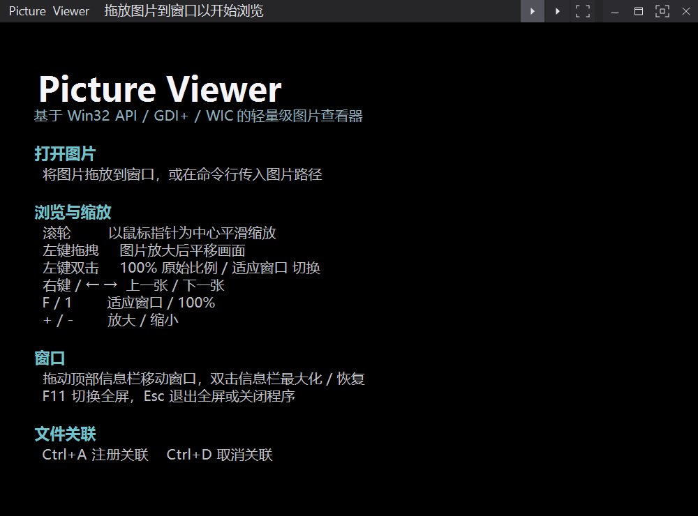

  

# Picture Viewer

轻量、快速、界面干净的图片查看器。打开图片、放大细节、翻看同目录照片，就这么简单。
A light, fast image viewer with a clean interface. Open a picture, zoom in on details, and browse photos in the same folder — nothing else.

[下载最新版 / Download the latest version](https://github.com/malik1988/PictureViewer/releases/latest)

---

## 截图 / Screenshots

### 浏览图片 / Viewing a photo

顶部信息栏会显示缩放比例、文件名、尺寸和文件大小。
The bar at the top shows the zoom level, file name, image size and file size.

### 首次打开 / Opening the app with no image

没有打开图片时，程序会直接显示操作说明，不需要先查文档。
When no image is open, the app shows a built-in cheat sheet so you can get started right away.

---

## 功能 / Features

- 启动快、体积小巧，界面只有图片本身。 / Starts instantly, stays tiny, and keeps the focus on your image.
- 滚轮以鼠标位置为中心平滑缩放，放大后还能拖动画面。 / Smooth zoom centered on your cursor, with easy drag-to-pan when zoomed in.
- 双击即可在「原始大小」和「适合窗口」之间切换。 / Double-click to switch between actual size and fit-to-window.
- 右键或方向键翻看同一文件夹里的其他图片。 / Right-click or use the arrow keys to browse other pictures in the same folder.
- 支持常见图片格式：JPG、PNG、GIF、BMP、TIFF、WEBP、ICO 等。 / Supports common image formats: JPG, PNG, GIF, BMP, TIFF, WEBP, ICO and more.
- 支持常见 3D 模型：OBJ、STL、PLY、OFF、GLB、glTF，可旋转、缩放查看。 / Views common 3D models: OBJ, STL, PLY, OFF, GLB and glTF, with rotate and zoom.
- 支持全屏浏览、拖拽文件到窗口打开。 / Fullscreen mode and drag-and-drop to open a file.
- 一键置顶，让图片始终显示在其他窗口前面。 / Pin the window so your image always stays on top.
- 支持 Windows 贴靠排版：拖到屏幕边缘即可半屏或四分之一屏排列。 / Works with Windows Snap: drag to a screen edge to arrange half or quarter screen layouts.
- 可把常见图片格式关联到本程序。 / Can be set as the default app for your image files.
- 纯黑背景、无边框窗口，顶部按钮可最大化、全屏、置顶和关闭。 / Borderless window with a black canvas and simple minimize, maximize, fullscreen, pin and close buttons.

---

## 使用方法 / How to use

### 打开图片 / Opening images

- 直接把图片拖到窗口里。 / Drag an image into the window.
- 双击 `PictureViewer.exe`，再把图片拖进来。 / Double-click `PictureViewer.exe`, then drop an image in.
- 在命令行中传入图片路径，例如 `PictureViewer.exe "D:\照片\海边.jpg"`。 / Pass a file path on the command line, for example `PictureViewer.exe "D:\Photos\beach.jpg"`.

### 鼠标和键盘 / Mouse and keyboard

| 操作 / Action | 功能 / What it does |
| --- | --- |
| 滚轮 / Scroll wheel | 以鼠标指针为中心缩放 / Zoom in or out around the pointer |
| 按住左键拖动 / Drag with left button | 移动放大后的图片 / Move the image when zoomed in |
| 左键双击 / Double-click | 100% 原始大小与适合窗口之间切换 / Toggle between 100% and fit-to-window |
| 右键 / Right-click | 下一张图片 / Next picture |
| `←` / `→` | 上一张 / 下一张 / Previous / next picture |
| `Home` / `End` | 第一张 / 最后一张 / First / last picture |
| `F` / `1` | 适合窗口 / 100% 原始大小 / Fit to window / actual size |
| `+` / `-` | 放大 / 缩小 / Zoom in / zoom out |
| `F11` | 进入或退出全屏 / Enter or exit fullscreen |
| `P` | 置顶或取消置顶 / Pin or unpin the window |
| `Esc` | 退出全屏；普通窗口下关闭程序 / Exit fullscreen, or close the app |
| 3D 模型：左键拖动 / 3D model: drag with left button | 旋转模型 / Rotate the model |
| 3D 模型：滚轮 / 3D model: scroll wheel | 拉近或拉远 / Zoom in or out |
| 3D 模型：双击 / 3D model: double-click | 重置视角 / Reset the view |
| 拖动顶部信息栏 / Drag the top bar | 移动窗口；拖到屏幕边缘自动排版 / Move the window; drag to an edge to snap |
| 双击顶部信息栏 / Double-click the top bar | 最大化或还原窗口 / Maximize or restore the window |
| `Win` + `←` / `→` | 贴靠到左 / 右半屏 / Snap to the left / right half |
| `Win` + `↑` / `↓` | 最大化 / 还原并缩小 / Maximize / restore and shrink |

### 关联文件类型 / Set as default viewer

按 `Ctrl+A` 即可把常见图片与 3D 模型格式（OBJ、STL、PLY、OFF、GLB、glTF）关联到 Picture Viewer（只对当前用户生效，不需要管理员权限；程序会自动使用自身所在路径）。
Press `Ctrl+A` to associate common image formats and 3D models (OBJ, STL, PLY, OFF, GLB, glTF) with Picture Viewer. It only affects your own account and does not need administrator rights. The app uses its own location automatically.

按 `Ctrl+D` 取消关联。 / Press `Ctrl+D` to remove the association.

也可以双击发布包里的 `associate.reg`，然后按提示修改其中的程序路径。
You can also run `associate.reg` from the download and update the program path inside it.

---

## 常见问题 / FAQ

**需要安装吗？ / Does it need installation?**

不需要。解压压缩包，运行 `PictureViewer.exe` 即可；删除文件夹即可卸载。
No. Unzip the archive and run `PictureViewer.exe`. To uninstall, just delete the folder.

**支持哪些系统？ / Which Windows versions are supported?**

Windows 10 及更高版本（64 位）。 / Windows 10 or newer, 64-bit.

**打不开某张图片怎么办？ / What if an image will not open?**

请确认文件没有损坏，或尝试用其他格式重新保存。图片支持 JPG、PNG、GIF、BMP、TIFF、WEBP、ICO 等；3D 模型支持 OBJ、STL、PLY、OFF、GLB、glTF（仅显示几何，不含材质与动画）。
Check that the file is not damaged, or try saving it in another format. Images: JPG, PNG, GIF, BMP, TIFF, WEBP, ICO and more. 3D models: OBJ, STL, PLY, OFF, GLB, glTF (geometry only, no materials or animation).

**全屏后怎么退出？ / How do I leave fullscreen?**

按 `F11` 或 `Esc`。 / Press `F11` or `Esc`.

**怎么让窗口一直显示在最前面？ / How do I keep the window on top?**

点击标题栏上的图钉按钮，或按 `P`。再次操作即可取消。
Click the pin button in the title bar, or press `P`. Do it again to unpin.

**能和 Windows 一起分屏吗？ / Can I snap it beside other windows?**

可以。把标题栏拖到屏幕左/右边缘即可半屏排列，也可以使用 `Win` + 方向键。
Yes. Drag the title bar to the left or right edge to snap it, or use `Win` + the arrow keys.

---

## 下载 / Download

最新版本与历史版本都在 GitHub Releases：
Latest and previous versions are available on GitHub Releases:

https://github.com/malik1988/PictureViewer/releases
